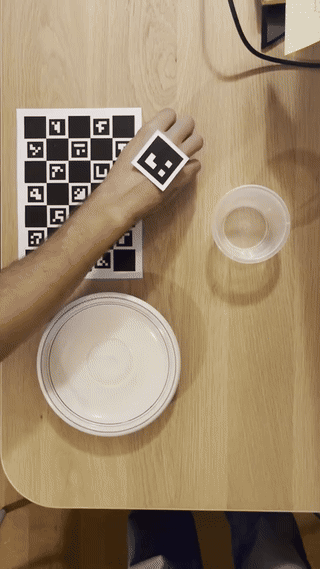
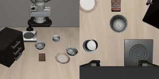
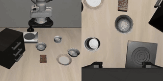

# Human video → robot demonstrations → SmolVLA

A phone-recorded bowl-transfer dataset, a marker-based retargeting pipeline for LIBERO, and a SmolVLA fine-tuning experiment.

Built for the [Humanoid Robot Learning Research challenge](https://jobs.ashbyhq.com/humanoid/e1a2a9de-ad23-4632-9d93-ee50fd41a221), which asks applicants to use personally collected real data to drive a simulated manipulator and explain their method, outputs, and findings.

**Status — 15 October 2026:** 16 reviewed human-derived robot episodes have been generated and exported. SmolVLA was fine-tuned for 2,000 updates. Its first autonomous evaluation failed to grasp the bowl. Successful retargeting and learned-policy performance are reported separately below. A continuation experiment with extra startup sampling is prepared, but no result from it is claimed here.

## Demonstrations

| Personally recorded human video | Human-derived robot demonstration |
|---|---|
|  |  |
| [Watch video](docs/media/human_demo.mp4) — real time | [Watch video](docs/media/retargeted_demo.mp4) — **16× playback** |

The robot video above is generated by the retargeter, **not by the trained VLA**. Playback is accelerated for presentation; the actual demonstrations are slow. The phone video is a fixed overhead recording, not an egocentric camera stream.

**Learned policy, 2,000 updates — unsuccessful:**

[](docs/media/vla_step_002000.mp4)

[Watch policy evaluation](docs/media/vla_step_002000.mp4), at **16× playback**. The wrist rotates and drifts away; no finger–bowl contact occurs. This failed rollout is retained as an experimental result.

## Task

- Simulator: **LIBERO**, built on robosuite and MuJoCo.
- Suite: `libero_spatial`.
- Task: `pick_up_the_black_bowl_from_table_center_and_place_it_on_the_plate`.
- Embodiment: mounted Franka Panda with a parallel-jaw gripper.
- Goal: place the central black bowl on the plate and release it.
- Scope: one task and a fixed simulation scene. Generalization to new scenes is not claimed.

The task is resolved by name rather than a numerical suite index. See [task configuration](configs/task.json).

## How the human data is used

```mermaid
flowchart LR
    A[Personal phone recordings] --> B[ChArUco board and hand-marker tracking]
    B --> C[Reviewed grasp and placement events]
    C --> D[Map human transfer path into LIBERO]
    D --> E[Robot controller and contact checks]
    E --> F[Review successful episodes]
    F --> G[LeRobot dataset]
    G --> H[SmolVLA fine-tuning]
    H --> I[Autonomous policy evaluation]
```



An iPhone 13 mini records a hand moving a bowl onto a plate. OpenCV estimates the hand marker's 3D position relative to a ChArUco board. Manual event annotations delimit grasp and placement. The marker measures a point on the hand, not the fingertips or the bowl pose.

For the transfer, the mapper separates the human path into a straight endpoint connection and a residual curve. It rotates and scales the horizontal residual to match the simulator's grasp and destination, preserving the vertical residual in metres. This makes human lift height and path shape affect the generated robot trajectory.

**Engineered components:** approach, rim grasp, fixed wrist orientation, contact-based placement, release, withdrawal, and timing adaptation. The controller recomputes targets from simulation geometry. It follows the human transfer waypoints while checking contact and relative bowl drift.

**Learned component:** SmolVLA is trained on simulator observations paired with the actions produced by this process. At evaluation, the VLA controls every action; the retargeting controller does not assist it.

The phone images themselves are not VLA training inputs. The approach is human-motion-derived robot supervision, not direct imitation of raw human pixels. MediaPipe, reinforcement learning, and world models were not used in the reported experiment.

## Data and model

| Item | Configuration |
|---|---|
| Human collection | 17 batch recordings; one tracking failure excluded; 16 retained, plus an earlier pilot |
| Tracking | `DICT_4X4_50`, hand marker ID 49, 40 mm black square |
| Calibration board | 5 × 7 squares; 30 mm squares, 22 mm embedded markers |
| Reviewed robot dataset | **16 episodes, 71,274 transitions**, 20 Hz |
| Visual inputs | External and wrist cameras, upright RGB, 256 × 256 |
| State | End-effector XYZ, principal rotation vector, two finger positions: 8 values |
| Actions | 7 normalized relative `OSC_POSE` commands: translation, rotation, gripper |
| Foundation model | [`lerobot/smolvla_base`](https://huggingface.co/lerobot/smolvla_base) |
| Training | Batch 1; AdamW; learning rate `1e-5`; weight decay `0.01`; gradient clipping `1.0` |
| Action chunks | 50 predicted actions; 10 executed before the next prediction chunk |
| Reported checkpoint | 2,000 optimizer updates; about 99.9M trainable parameters |
| Compute | MacBook Pro M2 for preparation; Colab T4 for training and evaluation |

All approved episodes are used for training. There is no held-out split in this proof of concept. Episode boundaries are preserved, including action padding at episode ends; no chunk is allowed to draw target actions from the next episode. Export verifies sampled image/action read-back and writes provenance and preprocessing metadata.

## Results and interpretation

| Measurement | Result |
|---|---:|
| Reviewed successful retargeted episodes included in training | 16 |
| Mean loss, first / last 500 updates | 1.063 / 0.580 |
| Median loss, first / last 500 updates | 0.502 / 0.144 |
| Autonomous trials reported | 1, recorded training scene, seed 42 |
| Autonomous task completion | **0 of 1 trials** |
| Evaluation duration | 6,000 steps; 300 simulated seconds; ~50 minutes wall time |
| Finger–bowl contact during policy rollout | 0 steps |

The 16 reviewed episodes are a selected training set, not a retargeting success-rate estimate across all attempts. Likewise, one failed VLA rollout is not a statistical benchmark.

Training loss fell, but large spikes persisted around the startup sequence. Offline checks reproduced training/evaluation preprocessing on recorded samples and found incorrect predictions before the approach: premature wrist rotation, a positive Y-command bias, and a missed transition toward the bowl. Repeated engineered startup phases are similar across demonstrations, so these are not independent startup examples.

[Startup prediction plot](docs/results/startup_predictions.png) · [Retargeting report](docs/results/retarget_demo_001.json) · [VLA evaluation report](docs/results/vla_step_002000.json)

### What worked

- Phone video and inexpensive printed markers provided useful transfer-shape supervision.
- Contact-aware retargeting produced complete grasp–transfer–release episodes.
- Recording locally before copying to Drive removed repeated remote HDF5 writes.
- Source tracking, explicit review, and export checks kept unsuccessful attempts out of training.

### What did not work yet

- The 2,000-update VLA failed to approach and grasp in closed loop, despite lower training loss.
- Slow bounded commands and waypoint settling produce long demonstrations and evaluations.
- The initial scripted wait has little observable change; its exact transition time is ambiguous to a policy without an explicit phase clock.
- A transparent bowl reduced annotation visibility; compressed preview quality made this worse.
- A fixed scene and few independent human trajectories limit coverage and recovery behavior.

Next experiment: continue the saved optimizer/model checkpoint and sample 30% of training chunks from frames 0–350, while retaining 70% from the rest. Verify startup predictions before another full rollout. This experiment is configured, not yet a reported improvement.

## Run the project

### Environment

Simulation and training were run in Linux/Colab. Start with a GPU runtime for rendering/training and install the dependencies used by the notebooks:

```bash
git clone https://github.com/huggingface/lerobot.git /content/lerobot
python -m pip install -e '/content/lerobot[libero,smolvla]'
python -m pip install num2words
```

For a separate local tracking environment:

```bash
python3 -m venv .venv
source .venv/bin/activate
python -m pip install numpy opencv-contrib-python
```

Install dependencies before importing Transformers; restart the session if `num2words` was installed after processor imports. Configure `MUJOCO_GL=egl` and `PYOPENGL_PLATFORM=egl` before importing simulation libraries in Colab.

Observed runtime versions included Python 3.13, LeRobot 0.6.2, hf-libero 0.1.4, robosuite 1.4.0 and MuJoCo 3.8.1. The editable LeRobot installation was not recorded with a Git commit; this is **not a complete reproducibility lock**. Notebook and report version checks should be reviewed after installation rather than assuming the latest upstream code is identical.

### Review the included example

Small tracked trajectories, annotations and camera calibration are included under [examples/demo_001](examples/demo_001). The README videos are compressed presentation copies; do not use them for calibrated tracking.

To generate a new robot episode from the included tracked human path in a configured Linux environment:

```bash
mkdir -p data/processed/example_demo
cp examples/demo_001/marker_smoothed.csv data/processed/example_demo/
cp examples/demo_001/human_events.json data/processed/example_demo/
printf 'n\n' | python scripts/retarget_episode.py \
  --project "$PWD" --demo example_demo \
  --output /content/example_demo_run
```

Use an output directory that does not exist yet. This reruns the engineered retargeter, not the trained policy. Inspect its report and replay. The copied event file retains the original recording reference for provenance.

### Full collection → training workflow

The notebooks assume the project is at `/content/drive/MyDrive/Projects/humanoid-challenge`; change `project` if using another location.

| Notebook | Purpose |
|---|---|
| [02](notebooks/02_camera_calibration.ipynb) | Camera calibration |
| [08](notebooks/08_batch_human_retargeting.ipynb) | Register videos, track markers, annotate, retarget, review |
| [09](notebooks/09_export_batch_training_dataset.ipynb) | Export approved episodes to LeRobot and verify boundaries |
| [10](notebooks/10_train_smolvla_batch.ipynb) | Train, evaluate, diagnose predictions, resume a checkpoint |

Notebook 10 contains independent fresh-training, evaluation, diagnostic, and continuation sections. **Do not run the whole notebook blindly:** choose the relevant section. Historical export/checkpoint IDs must be replaced with your own outputs for a new run. Earlier notebooks 01 and 03–07 document pilot experiments; the README describes the current batch workflow.

For batch commands and recording dimensions, see [the batch guide](docs/04_batch_retargeting.md). For read-only path/timing analysis:

```bash
python scripts/analyze_retarget_batch.py --project "$PWD"
python -m unittest discover -s tests -v
```

## What is and is not in Git

Included: source code, clean notebook sources, task configuration, a small human-trajectory example, compressed media, and selected results.

Excluded: full phone recordings, HDF5 robot datasets, LeRobot exports, simulator assets, model/optimizer checkpoints, runtime manifests, and notebook execution outputs. The complete training dataset and checkpoint are not hosted in this repository yet, so an independent reviewer can inspect/re-run the small retargeting example but cannot reproduce the reported full training run from this checkout alone. No download link is claimed until those artifacts are actually published.

The local Git clean filter removes notebook outputs and execution metadata from commits while keeping the working notebooks intact. After cloning, enable it before committing executed notebooks:

```bash
git config filter.clean-notebook.clean 'python3 scripts/clean_notebook.py'
git config filter.clean-notebook.required true
```

No license grant is added for third-party models, simulator assets, or datasets; their original terms apply. This project is an independent applicant experiment, not an official Humanoid implementation.

## References

- [Humanoid challenge and submission requirements](https://jobs.ashbyhq.com/humanoid/e1a2a9de-ad23-4632-9d93-ee50fd41a221)
- [LIBERO](https://github.com/Lifelong-Robot-Learning/LIBERO)
- [LeRobot](https://github.com/huggingface/lerobot)
- [SmolVLA documentation](https://huggingface.co/docs/lerobot/smolvla)
